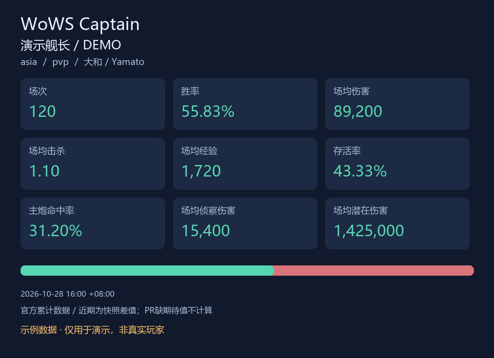
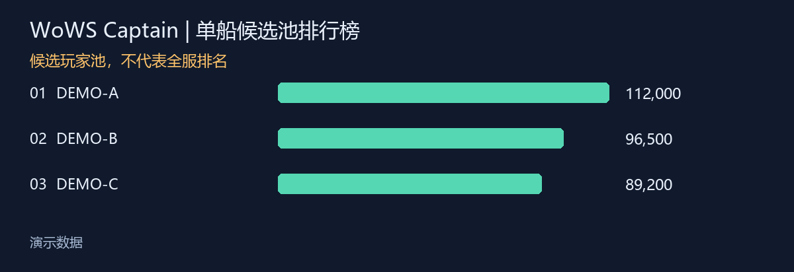

# 战舰世界舰长助手 · AstrBot 插件

支持亚服、欧服、美服的战绩查询与图片输出，接入浩舰完整舰船参数，提供中文战术知识检索、战绩截图分析、复盘和群聊主动参与。Kokomi V4 通过独立桥接服务接入，保留原引擎命令和图表。

**从这里安装：[零基础逐步安装指南](docs/安装指南.md)。** 需要 AstrBot 4.29.1 及以上、Python 3.12 及以上。已有 AstrBot 的用户，在插件页面选择“从链接安装”，填写：

```text
https://github.com/brochure325/1
```

## 可以直接做什么

- **战绩**：绑定账号、总体与单船战绩、随机战/单野/双排/三排/排位/公会战模式、舰种加权统计、历史船池、近期快照差值、累计胜率趋势、单船候选玩家排行，输出 PNG 图。
- **舰船参数**：从 [浩舰](https://iwarship.net/wowsdb/index) 实际接口查询舰船名称、主炮、鱼雷、副炮、防空、舰载机、空袭、反潜、声呐、消耗品、弹道穿深和特殊机制，保留所有模块配置与原始详情。聊天分页展示，附完整 JSON。
- **高级攻略**：内置原创大局意识、五大舰种、混合舰、机制与资源交换、随机/排位/竞技差异、复盘训练；检索有出处的赛事事实与教学摘要。管理员可导入经授权的赛事记录和专家教学笔记。
- **教练分析**：分析刚查到的结构化战绩，也能读同条或引用消息中的战绩图片。区分事实与待验证假设，给出可检查的训练目标。
- **自然讨论**：接住具体的游戏抱怨，针对局面和设计给观点；不会把“控胜率”等未经证实的说法当作事实。
- **主动参与**：检测平台投递的战舰世界关键词及同会话上下文；疑问直接回答，一般讨论按间隔插话。管理员可以按会话开关或配置范围。
- **Kokomi 接入**：将 `/wws ...` 原样送到用户已经配置、获授权的 V4 引擎，接回原版文字和图片。与 AstrBot 分进程运行，保留原后端拥有的完整历史、全服排行榜、赛季和其它功能。

## 数据条件与范围

**v1.0.1安装修复**：已取消Pillow不必要的`<13`上限，允许沿用AstrBot Core固定的Pillow 13.0.0；兼容声明调整为AstrBot 4.29.1+。遇到旧版依赖冲突时，先更新插件代码再重试加载，不要降级Core依赖或关闭依赖保护。具体步骤见安装指南第15.2节。

1. 原生国际服战绩查询需要自行申请 **WG application_id**，没有游戏密码登录。国服不使用这三个国际服接口。
2. 官方公开接口提供累计数据。原生“近期”从本插件保存的真实快照计算；刚装好不能恢复过去尚未采样的记录，实际时间区间会显示。逐局历史使用有该数据的 Kokomi 后端。
3. 原生排行榜统计本会话已经绑定的候选玩家，明确标记范围。Kokomi 的全服榜、全球榜和专有评分需要其原数据服务；不能把候选池榜称为全服榜。原生 PR 缺少期待值时显示未计算。
4. 浩舰公开数据可以匿名查询。使用本人已登录 Cookie 时，只有网站明确返回登录标记才报告已认证；Cookie 存在不等于登录成功。账号验证与权限受浩舰控制。详见[浩舰接入](docs/浩舰接入.md)。
5. 识图需要可用的视觉模型，聊天、主动讨论和模型分析会产生所选模型服务的费用。截图、问题和相关战绩会发送至管理员选定的模型服务。
6. 知识库检索用于支持分析，不会把基础模型训练成冠军选手；助手不虚构冠军身份。赛事规则和旧教学会注明来源与适用背景。不能仅凭聚合统计还原玩家的每一步意识。
7. 主动监听的范围是 **AstrBot 接收到的平台消息**，不读取服务器日志文件、不倒灌历史群聊。平台没有投递的消息，插件无法看到。QQ 官方机器人的权限可能限制普通群消息获取。

完整需求逐项对应见[功能与 Kokomi 命令对照](docs/功能对照.md)。

## 首次配置与试用

1. 在 AstrBot 插件配置填 `wg_application_id`，默认服务器选 `asia`、`eu` 或 `na`。
2. 在 AstrBot 配置聊天模型；插件的聊天模型留空可跟随当前会话。截图分析另外选择支持图片输入的模型。
3. 在测试会话发送 `/wows 帮助` 和 `/wows 状态`。
4. 用真实游戏昵称替换下面示例中的 `你的昵称`：

```text
/wows 绑定 asia 你的昵称
/wows 战绩
/wows 单船 大和
/wows 近期 7
/wows 浩舰 大和
/wows 浩舰详情 PJSB018 主炮
/wows 攻略 驱逐舰如何判断是否应该进点
/wows 复盘
```

带空格的昵称或舰名用英文双引号包住。用 `--mode pvp_solo` 切换单野，`--mode rank_solo` 切换排位。更多命令可发 `/wows 帮助`。

登录浩舰和连接 Kokomi 都通过服务端环境变量/文件管理凭据，**不要向群聊或 GitHub 发密码、Cookie 或密钥**。

## 图表演示

下图使用人工构造的演示数据，不是任何真实玩家的战绩。





## 详细文档

- [零基础安装、模型配置、消息平台与排错](docs/安装指南.md)
- [浩舰匿名查询、本人登录会话与全参数输出](docs/浩舰接入.md)
- [Kokomi 原引擎与授权后端接入](docs/Kokomi接入.md)
- [高级攻略全文](docs/高级攻略.md)
- [赛事记录、专家教学与本地知识库导入](docs/知识库与赛事导入.md)
- [功能对照与可验证边界](docs/功能对照.md)
- [验证记录](docs/验证记录.md)

## 开发与验证

在插件根目录执行（在 Windows 的 PowerShell 中可把 `python` 换成自己环境的完整路径）：

```bash
python -m pip install -r requirements.txt
python -m unittest discover -s tests -v
python scripts/doctor.py
python scripts/smoke.py
```

最后一条会实际访问浩舰公开数据；它不会拿不存在的账号假装通过登录。WG 和原版 Kokomi 的真实查询须提供自己的应用 ID/原引擎授权，测试说明单独记录。

## 致谢与许可

本插件自有代码采用 [MIT](LICENSE)。通过标准插件接口适配 [AstrBot](https://github.com/AstrBotDevs/AstrBot)，不捆绑框架代码。Kokomi 由 [SangonomiyaKoko/Kokomi_Bot](https://github.com/SangonomiyaKoko/Kokomi_Bot) 提供，原项目注明 **CC BY-NC 4.0**；桥接服务不捆绑其代码、字体或图片，也不提供其后端账号。使用原版时须遵守其许可和服务约定。浩舰与 Wargaming 数据在运行时获取，归对应权利人所有。详见 [第三方说明](THIRD_PARTY_NOTICES.md)。
